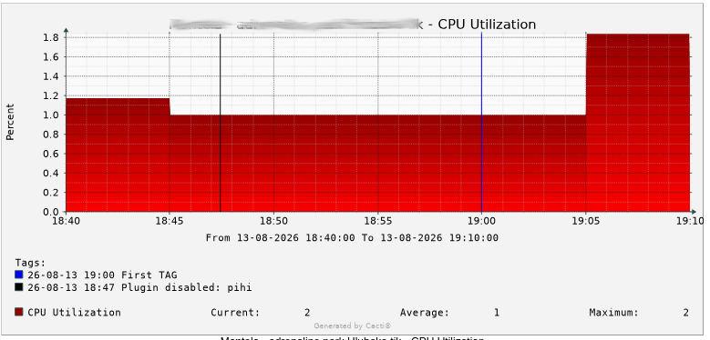

# Plugin Tags

The plugin allows you to create colour tags and display them in graphs. 
It supports both manually entered tags and automatic tags.



Tags can be assigned to a device (displayed on all its graphs), 
to a specific graph for a single device, to all graphs for all devices 
within the same site ID, or to all graphs. There is also the option 
to set a default device and display, for example, system tags only on that device.

It is possible to enable automatic graphs, for example, for device restarts 
or reindexing, plugins (enabling, disabling, updating), Cacti version, etc.

When there are a large number of tags, not all of them are displayed in the graph. 
Instead, they are summarised and only the most recent few are shown.

It is also possible to archive old tags. These are then not displayed in the graph.


## Versions and compatibility

This README describes the `develop` source branch.

| Code | Plugin version | Minimum Cacti declared in `INFO` |
| --- | --- | --- |
| [Source branch](INFO) | 0.1 | 1.2.29 |

No GitHub release is published for this repository. The source version above
is not a published-release designation. Follow the development caveats and
requirements in this README before deployment.

Install this plugin in **`<cacti-root>/plugins/tags`**, using the directory
name `tags` rather than `plugin_tags`.

See [CHANGELOG.md](CHANGELOG.md) for the version history.

## Cacti compatibility

If you are running a version of Cacti below 1.2.31, please add the function
below to the `applySkin()` function in `include/layout.js` to enable the Cancel
buttons on forms to work:

```js
$(document).off('click.cactiReturnTo', '.cactiReturnTo')
    .on('click.cactiReturnTo', '.cactiReturnTo', function(event) {
        event.preventDefault();
        cactiReturnTo($(this).attr('data-url'));
    });
```


## Installation

To install the Tags plugin, simply copy the plugin_tags directory to
Cacti's plugins directory and rename it to simply 'tags'. Once you have done
this, goto Cacti's Plugin Management page, Install and Enable the Tags plugin. Once
this is complete, you can grant users the **Plugin Tags - view** realm, which
is the only realm the plugin registers.

Go to Management -> Tags

## Settings

The **Tags** tab under Settings holds the following options:

* **Hide tags in graphs** - do not display tags in graphs.
* **Data Retention** - after this time, tags are moved to the archive and are no
  longer displayed.
* **Graph legend limit** - if the number of tags is bigger than the limit, the
  legend is aggregated.
* **Select Primary Device** - typically a local Cacti device, where tags
  related to the Cacti system are displayed.

The remaining options enable automatic tags (and their colors) for device
restarts, added devices, device changes, data source reindexing, the Cacti
version, poller overruns, data collector status and plugin status.


## Bugs and Feature Enhancements

Bug and feature enhancements for the Tags plugin are handled in GitHub. If
you find a first search the Cacti forums for a solution before creating an issue
in GitHub - https://github.com/Cacti/plugin_tags

You can find more information on our forum - https://forums.cacti.net/viewtopic.php?t=64137 

-----------------------------------------------
Copyright (c) 2004-2026 - The Cacti Group, Inc.

